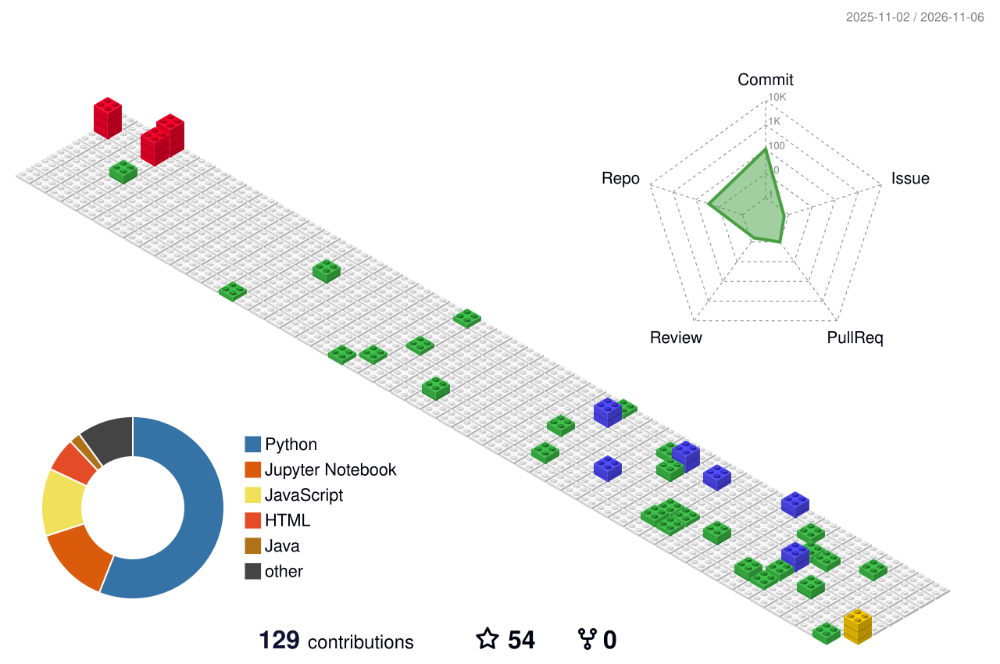

<div align="center">

# 👋 Hi, I'm Shivani Sharma

### Software Development Engineer Intern | AI/ML Enthusiast | Full-Stack Developer

Building intelligent applications, practical AI solutions and scalable software.

[](https://www.linkedin.com/in/shivani-sharma-1a7737289/)
[](https://github.com/shivxnii)
[](https://leetcode.com/u/Shivani_2511/)

</div>

---

## 🚀 About Me

```java
class ShivaniSharma {

    String role =
        "Software Development Engineer Intern @ RYM Grenergy";

    String education =
        "B.Tech CSE (AI & ML) | K.R. Mangalam University";

    String graduation = "2027";

    String interests[] = {
        "Artificial Intelligence",
        "Machine Learning",
        "Computer Vision",
        "Full Stack Development",
        "Backend Engineering",
        "System Design"
    };

    String achievements[] = {
        "SIH 2025 Finalist",
        "AIWH 2025 Finalist",
        "Deep Data Hackathon - 3rd Rank"
    };

    String currentlyLearning[] = {
        "Java",
        "Data Structures & Algorithms",
        "Spring Boot",
        "System Design"
    };
}
```

---

## 💼 Experience

### 💜 Software Development Engineer Intern — RYM Grenergy

- Working on AI-powered software and automation solutions.
- Mineral classification and intelligent dashboard development.
- Warehouse automation and vehicle monitoring systems.
- Computer vision, ANPR and OCR integrations.
- Working with FastAPI, Node.js and modern web technologies.

### 💙 Former Software Development Intern — WebMobril Technologies

- Developed an internal enterprise search engine.
- Worked on AQI forecasting.
- Built a scientific calculator using Python and Tkinter.
- Explored backend development and application development.

---

## 🏆 Achievements

- 🥇 Smart India Hackathon 2025 — Grand Finale Finalist
- 🥇 AIWH 2025 — Top 25
- 🥉 Deep Data Hackathon — 3rd Position
- 🏅 Mathematics Olympiad — Class 10

---

## 🛠️ Tech Stack

### 💻 Programming Languages


### 🌐 Frontend Development


### ⚙️ Backend Development


### 🗄️ Database


### 🤖 AI / Machine Learning


### 🔧 Tools & Platforms


---

## 📚 Currently Learning

- Java and Advanced DSA
- Spring Boot
- System Design
- Backend Engineering
- Advanced AI/ML applications

---

## 🚀 Featured Projects

### 🪨 MineralVision
**AI-Powered Mineral Classification Dashboard**

- Deep learning-based mineral classification.
- Image upload and mineral prediction.
- Prediction history and analytics dashboard.
- Model integration with FastAPI and Node.js.

**Tech:** TensorFlow · PyTorch · FastAPI · React · Node.js · MongoDB

### 🚚 Smart Warehouse Automation
**Vehicle Entry / Exit Detection System**

- Truck detection and tracking.
- Automatic Number Plate Recognition.
- OCR-based text extraction.
- Automated vehicle entry logs.
- Real-time monitoring dashboard.

**Tech:** Python · YOLO · OpenCV · OCR · ANPR

### ⛏️ Mine Sarthi
**Smart India Hackathon 2025 Finalist**

- Digital twin for mining operations.
- Energy optimization and monitoring.
- LSTM-based predictive analytics.
- IoT-based equipment monitoring.
- AI-powered safety monitoring.

**Tech:** Python · IoT · LSTM · OpenCV · FastAPI

### 🤖 AI Sakhi
**Bilingual Voice-Enabled AI Assistant**

- Hindi and English voice support.
- AI-assisted KYC form filling.
- Speech recognition and natural language processing.
- Conversational assistant experience.

**Tech:** Python · NLP · Speech Recognition · AI

---

## 📊 GitHub Analytics

<div align="center">


</div>

---

## 🧊 3D Contribution Calendar

<div align="center">

### My GitHub Contributions — In 3D



</div>

---

## 💻 Coding Profiles

<div align="center">

[](https://leetcode.com/u/Shivani_2511/)

[](https://github.com/shivxnii)

[](https://www.linkedin.com/in/shivani-sharma-1a7737289/)

</div>

---

## 🌱 Currently Working On

- AI-powered warehouse automation
- Computer vision and object detection
- Backend development
- Intelligent monitoring systems
- Java and System Design

---

<div align="center">

### 💜 Code. Learn. Build. Repeat.

*"Turning ideas into intelligent solutions, one commit at a time."*

⭐ If you like my work, consider starring my repositories!

</div>
