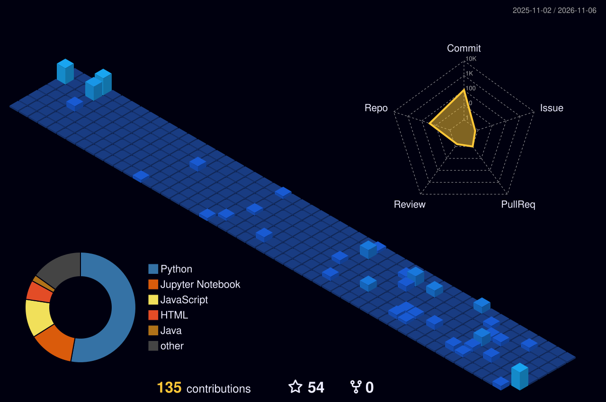

 

  

**Turning ideas into intelligent solutions through code, creativity and engineering.**

---

## `01` — The Developer Behind the Code

Hey there! I'm **Shivani Sharma**, a Computer Science undergraduate specializing in Artificial Intelligence and Machine Learning at K.R. Mangalam University.

Currently working as a Software Development Intern, I enjoy building practical applications that combine intelligent algorithms, backend engineering and modern software development.

I am particularly interested in:

- Artificial Intelligence & Machine Learning
- Computer Vision and Deep Learning
- Backend & Full-Stack Development
- Intelligent Automation
- Data Structures & Algorithms
- Scalable Software Systems

 

---

## `02` — Engineering Journey

<table>
<tr>
<td width="50%" valign="top">

### 🎓 Education

**B.Tech — Computer Science & Engineering**

Artificial Intelligence & Machine Learning

K.R. Mangalam University

2023 – 2027

</td>
<td width="50%" valign="top">

### 💼 Experience

**Software Development Intern**

RYM GRENERGY

AI-powered applications, computer vision, automation and intelligent monitoring systems.

**Former Software Development Intern**

WebMobril Technologies

Enterprise search, AQI forecasting and Python application development.

</td>
</tr>
</table>

---

## `03` — Recognition & Achievements

| Achievement | Recognition |
|---|---|
| Smart India Hackathon 2025 | Grand Finale Finalist |
| AIWH Hackathon | Top 25 |
| Deep Data Hackathon | 3rd Position |
| Mathematics Olympiad | School-level achievement |

---

## `04` — Technology Arsenal

### Programming Languages

### AI / Machine Learning

### Backend & Databases

### Development Tools

---

## `05` — Selected Engineering Projects

### ⛏️ Mine Sarthi
**AI-powered Mining Intelligence & Digital Twin**

*Smart India Hackathon 2025 — Grand Finale Project*

- Digital twin-based mining operations monitoring.
- LSTM-based predictive analytics.
- IoT sensor integration for equipment monitoring.
- Computer vision-based safety monitoring.

`Python` `LSTM` `OpenCV` `ESP32` `MQTT` `FastAPI`

---

### 🪨 MineralVision
**Intelligent Mineral Classification & Monitoring Platform**

- Deep learning-based mineral image classification.
- Model integration with a prediction service.
- Interactive monitoring and analytics dashboard.
- Prediction history and model management.

`Python` `TensorFlow` `EfficientNetB3` `FastAPI` `Node.js`

---

### 🚛 Container Yard Monitor
**Computer Vision-Based Container Tracking System**

- Container detection and tracking.
- Video-based monitoring and live simulation.
- Container identification using OCR.
- Interactive yard visualization and movement tracking.

`Python` `OpenCV` `OCR` `Node.js` `JavaScript`

---

### 🤖 AI Sakhi
**Bilingual Voice-Enabled AI Assistant**

- Hindi and English voice interaction.
- AI-assisted KYC form filling.
- Speech recognition and NLP-based interaction.

`Python` `NLP` `Speech Recognition` `AI`

---

## `06` — GitHub Analytics

---

## `07` — Contributions in 3D

### Every commit is a step forward.

---

## `08` — Currently Exploring

---

## `09` — Let's Connect

I'm always interested in collaborating on meaningful projects, exploring innovative ideas and connecting with fellow developers.

  

**BUILD • EXPLORE • INNOVATE • REPEAT**

